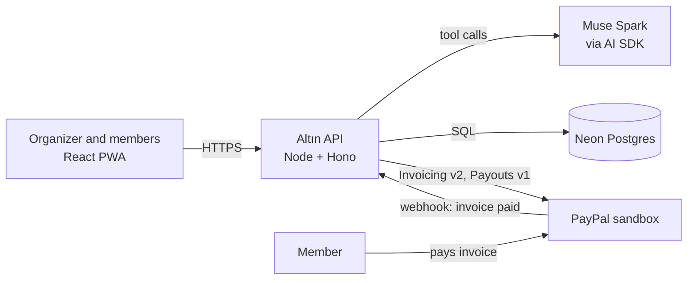

# Altın

[](https://github.com/mayarkmkhlh/altin/actions/workflows/ci.yml)

**AI treasurer for rotating savings circles.** Built for the PayPal AI Hackathon.

> **PayPal sandbox only. Concept demo, not a licensed payment or savings service. No real money moves.**
>
> **Altın orchestrates; PayPal holds funds; no custody.** Altın orchestrates PayPal and never holds funds.

**Live demo:** https://altin-ub0c.onrender.com (kept up until 15 Dec 2026; the first load can take up to a minute while the free server wakes)

## The problem

Rotating savings circles (altın günü, jam'iya, tanda, susu, chit funds) are how millions of people save: a group of friends each pay a fixed amount every month, and one member takes the whole pot each turn. They run on trust and a group chat. Someone has to chase payments, remember whose turn it is, and hand over the pot, and when that person makes a mistake, friendships suffer.

Altın does the treasurer's job. It builds the rotation, invoices every member through PayPal, watches the payments arrive, and prepares the payout to that month's host. A human always presses **Approve** before money moves.

## How a month works

1. The organizer tells the assistant who is in the circle and how much each person pays. It creates the circle and the rotation.
2. The assistant sends each member a real PayPal invoice.
3. Members pay on PayPal. PayPal's webhook tells Altın, and the board updates live.
4. When the pot is complete, the assistant proposes the payout to the host.
5. The organizer approves, and Altın sends the pot with PayPal Payouts.

## Architecture



- `apps/web`: React 19 + TypeScript (Vite). An installable PWA with English and Arabic (right-to-left) layouts.
- `apps/api`: Node + TypeScript (Hono). Serves the built web app, the agent, and the PayPal webhook.
- `apps/api/src/engine`: the circle rules (rotation, pot, who is next) as plain functions with unit tests.
- `apps/api/migrations`: numbered SQL migrations, applied on every start.
- `docs/decisions.md`: every design decision and its reason, including the security review.

### Webhook flow

A payment only counts when PayPal says so, and it counts once.

```mermaid
sequenceDiagram
  participant PP as PayPal
  participant API as Altın API
  participant DB as Postgres
  PP->>API: POST /webhooks/paypal (INVOICING.INVOICE.PAID)
  API->>PP: verify-webhook-signature
  PP-->>API: SUCCESS
  API->>PP: GET invoice (is it really PAID?)
  API->>DB: one transaction: insert event id, mark invoice paid, check pot, write audit row
  alt event id is new
    DB-->>API: committed
    API-->>PP: 200
  else repeat delivery (event id already stored)
    DB-->>API: no-op
    API-->>PP: 200
  end
  Note over API,PP: Any failure returns 500, so PayPal retries; the event id makes the retry safe.
```

## PayPal APIs used

| API | What Altın uses it for |
| --- | --- |
| OAuth 2.0 (`/v1/oauth2/token`) | Server-side access token; the secret never reaches the browser |
| Invoicing v2 | Create, send, remind, cancel and read each member's monthly invoice |
| Webhooks (`verify-webhook-signature`) | Prove each `INVOICING.INVOICE.PAID` event came from PayPal |
| Payouts v1 | Send the complete pot to the host after approval, then poll the batch until it settles |

## AI tools used, and how

**In the product.** The assistant runs on **Muse Spark** (Meta Model API) through the Vercel **AI SDK**. It can only act through three typed tools, each validated with zod and recorded in the audit log:

- `create_circle`: builds the circle and rotation from a plain-language description.
- `send_member_invoices`: creates and sends that month's PayPal invoices.
- `propose_payout`: checks every invoice is paid and queues the payout **for human approval**. The model has no tool that sends money; only the Approve button does, and the server re-checks the amounts before calling PayPal.

Agent calls are rate-limited (20 per visitor and 60 overall per hour).

**To build it.** Written with **Cursor** (agent mode) as a pair programmer: it wrote the code, tests and this README while I directed the design, reviewed each step and tested against the PayPal sandbox.

## Proof

- Webhook signature verification: tested in CI (forged event → 400 `missing signature headers`; verified live against the deployed endpoint)
- Idempotency: each PayPal event id is stored under a unique constraint, so a repeat delivery does nothing
- Approval gate: `propose_payout` only creates a request; a payout needs the organiser's tap on "Approve payout"
- CI: 

## Money and regulation

PayPal sandbox prototype. Funds stay in the organiser's PayPal account; Altın has no custody.
A live version would need SAMA licensing or a review with a licensed partner.

## For judges: try it

Open the [demo circle](https://altin-ub0c.onrender.com/circles/c2044677-ef41-4931-aa65-4c9a7531402e). Eight of nine members have paid; one invoice is open.

Sandbox test accounts (fake money, sandbox only):

| Role | Sandbox account |
| --- | --- |
| Member who pays (buyer) | `sb-0gv2053471726@personal.example.com` |
| Host who receives the pot | `sb-pqh9w53471606@personal.example.com` |

The sandbox passwords are in the submission form. Log in at [sandbox.paypal.com](https://www.sandbox.paypal.com) as the buyer to pay an open invoice, then watch the board update.

There is no login in this demo, so anyone with a circle link can view it and press Approve. The server still re-checks every payout before it sends anything. Real accounts would add sign-in, with only the host able to approve.

## Run locally

Requires Node 22+ and a Postgres database.

```bash
npm install
cp .env.example .env.local   # fill in DATABASE_URL, the PayPal sandbox keys and the model key
npx tsx --env-file=.env.local apps/api/src/migrate.ts
npm run dev:api        # http://localhost:3000
npm run dev:web        # http://localhost:5173
```

Checks: `npm run typecheck`, `npm test`, `npm run build`. CI runs all three on every push.

## Deploy

`render.yaml` is a Render Blueprint for the web service. The Postgres database is hosted on Neon; Render asks for its `DATABASE_URL` when the Blueprint syncs.

## License

[MIT](LICENSE)
